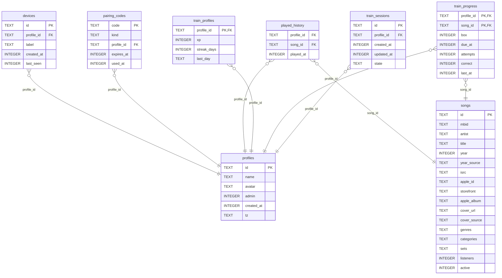

<!-- Generated by github.com/trick77/ship/kit/schemadoc, do not edit. Regenerate in the Go module directory: SCHEMADOC_UPDATE=1 go test ./... -run TestSchemaDoc -->

# Database schema

8 tables; the diagram is at the end. Go types are the `model.go` structs whose rows they hold.

## devices

Go types:

- `account.Identity` (internal/account): Identity is the paired device a request comes from and the profile it plays as.
- `account.deviceListJSON` (internal/account): deviceListJSON is one device GET /api/devices lists.

| Column | Type | Null | Default | PK |
| --- | --- | --- | --- | --- |
| `id` | TEXT | no |  | 1 |
| `profile_id` | TEXT | no |  |  |
| `label` | TEXT | no |  |  |
| `created_at` | INTEGER | no |  |  |
| `last_seen` | INTEGER | no |  |  |

Foreign keys:

- `profile_id` → `profiles` (`id`), on delete CASCADE

Indexes:

- `devices_profile` (`profile_id`)

## pairing_codes

| Column | Type | Null | Default | PK |
| --- | --- | --- | --- | --- |
| `code` | TEXT | no |  | 1 |
| `kind` | TEXT | no |  |  |
| `profile_id` | TEXT | no |  |  |
| `expires_at` | INTEGER | no |  |  |
| `used_at` | INTEGER | yes |  |  |

Foreign keys:

- `profile_id` → `profiles` (`id`), on delete CASCADE

Checks:

- `CHECK (kind IN ('device', 'invite'))`

## played_history

| Column | Type | Null | Default | PK |
| --- | --- | --- | --- | --- |
| `profile_id` | TEXT | no |  |  |
| `song_id` | TEXT | no |  |  |
| `played_at` | INTEGER | no |  |  |

Foreign keys:

- `song_id` → `songs` (`id`)
- `profile_id` → `profiles` (`id`), on delete CASCADE

Indexes:

- `played_history_profile` (`profile_id`, `played_at`)

## profiles

Go types:

- `account.profileListJSON` (internal/account): profileListJSON is one profile GET /api/profiles lists.

| Column | Type | Null | Default | PK |
| --- | --- | --- | --- | --- |
| `id` | TEXT | no |  | 1 |
| `name` | TEXT | no |  |  |
| `avatar` | TEXT | no |  |  |
| `admin` | INTEGER | no | `0` |  |
| `created_at` | INTEGER | no |  |  |
| `tz` | TEXT | no | `'UTC'` |  |

## songs

Go types:

- `deck.Song` (internal/deck): Song is a song as a round needs it. The answer (artist, title, year) never leaves the server before a reveal.

| Column | Type | Null | Default | PK |
| --- | --- | --- | --- | --- |
| `id` | TEXT | no |  | 1 |
| `mbid` | TEXT | yes |  |  |
| `artist` | TEXT | no |  |  |
| `title` | TEXT | no |  |  |
| `year` | INTEGER | no |  |  |
| `year_source` | TEXT | no |  |  |
| `isrc` | TEXT | yes |  |  |
| `apple_id` | TEXT | yes |  |  |
| `storefront` | TEXT | yes |  |  |
| `apple_album` | TEXT | yes |  |  |
| `cover_url` | TEXT | yes |  |  |
| `cover_source` | TEXT | yes |  |  |
| `genres` | TEXT | no | `'[]'` |  |
| `categories` | TEXT | no | `'[]'` |  |
| `sets` | TEXT | no | `'[]'` |  |
| `listeners` | INTEGER | yes |  |  |
| `active` | INTEGER | no | `1` |  |

## train_profiles

| Column | Type | Null | Default | PK |
| --- | --- | --- | --- | --- |
| `profile_id` | TEXT | no |  | 1 |
| `xp` | INTEGER | no | `0` |  |
| `streak_days` | INTEGER | no | `0` |  |
| `last_day` | TEXT | yes |  |  |

Foreign keys:

- `profile_id` → `profiles` (`id`), on delete CASCADE

## train_progress

Go types:

- `train.progress` (internal/train): progress is a song's spaced-repetition row.

| Column | Type | Null | Default | PK |
| --- | --- | --- | --- | --- |
| `profile_id` | TEXT | no |  | 1 |
| `song_id` | TEXT | no |  | 2 |
| `box` | INTEGER | no |  |  |
| `due_at` | INTEGER | no |  |  |
| `attempts` | INTEGER | no |  |  |
| `correct` | INTEGER | no |  |  |
| `last_at` | INTEGER | no |  |  |

Foreign keys:

- `song_id` → `songs` (`id`)
- `profile_id` → `profiles` (`id`), on delete CASCADE

## train_sessions

| Column | Type | Null | Default | PK |
| --- | --- | --- | --- | --- |
| `id` | TEXT | no |  | 1 |
| `profile_id` | TEXT | no |  |  |
| `created_at` | INTEGER | no |  |  |
| `updated_at` | INTEGER | no |  |  |
| `state` | TEXT | no |  |  |

Foreign keys:

- `profile_id` → `profiles` (`id`), on delete CASCADE

Indexes:

- `train_sessions_profile` (`profile_id`, `updated_at`)

## Types not stored as rows

### train.statsResponse

In `internal/train`. statsResponse is a profile's training stats, GET /api/train/stats: totals and sums over its progress.

| Field | Type | Doc |
| --- | --- | --- |
| `Award` | `string` |  |
| `XP` | `int` |  |
| `NextAt` | `*int` |  |
| `Mastered` | `int` |  |
| `Learning` | `int` |  |
| `New` | `int` |  |
| `StreakDays` | `int` |  |
| `Decades` | `[]decadeAccuracy` |  |

## Diagram

